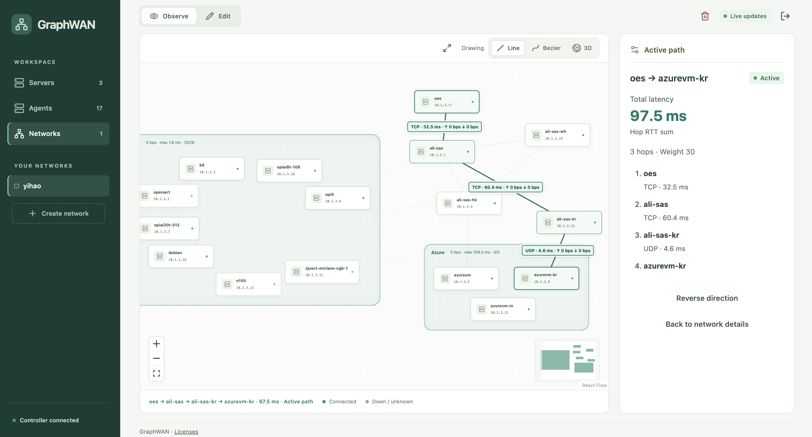

# GraphWAN

GraphWAN is a centrally managed overlay network. Draw connections between machines in the web panel and assign weights to choose which paths traffic takes. Agents forward encrypted packets directly or through other agents in the graph.

[Download a release](https://github.com/eWloYW8/GraphWAN/releases/latest) · [Quick start](#quick-start) · [Docker Compose](#docker-compose)



## Features

- Inspect a route hop by hop, see link latency and bandwidth, and switch between the topology diagram and a 3D globe.
- Connect peers across NAT using STUN and hole punching. Each edge can use UDP, TCP, QUIC, WebSocket or gRPC.
- Advertise a subnet through an agent, or connect a phone using a standard WireGuard client.

## Quick start

~~Give the agent the GitHub repository link and let it handle everything for you.~~

### Server

```sh
export GRAPHWAN_ADMIN_PASSWORD='replace-with-a-unique-password'
./graphwan server --listen 0.0.0.0:8443 --tls-hosts controller.example.net --data-dir ./graphwan-data
```

### Agent

Trust `graphwan-data/ca.pem` on your admin machine and open `https://controller.example.net:8443`. Under **Agents → Enroll agent**, create an invitation and save it on the machine you want to connect.

```sh
sudo ./graphwan agent enroll --invitation-file invitation.txt --data-dir /var/lib/graphwan-agent
sudo ./graphwan agent run --data-dir /var/lib/graphwan-agent
```

Under **Networks**, create a network, add two agents as nodes and draw an edge between them.

## Docker Compose

Copy [compose.yaml](compose.yaml) to each Linux host. On the server, set `GRAPHWAN_TLS_HOSTS` in `.env` to your controller's hostname.

```sh
export GRAPHWAN_ADMIN_PASSWORD='replace-with-a-unique-password'
docker compose up -d server
docker compose cp server:/data/server/ca.pem ./ca.pem
```

Trust `ca.pem` and create an invitation as in the [Agent](#agent) step. On each agent host:

```sh
docker compose run --rm -T agent agent enroll --data-dir /data/agent \
  --name "$(hostname)" --invitation-file - < invitation.txt
docker compose up -d agent
```
